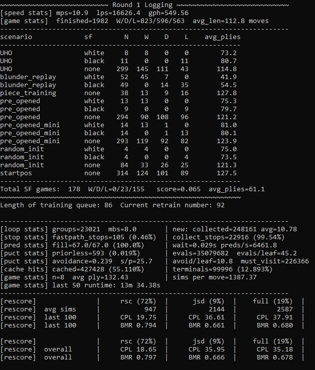
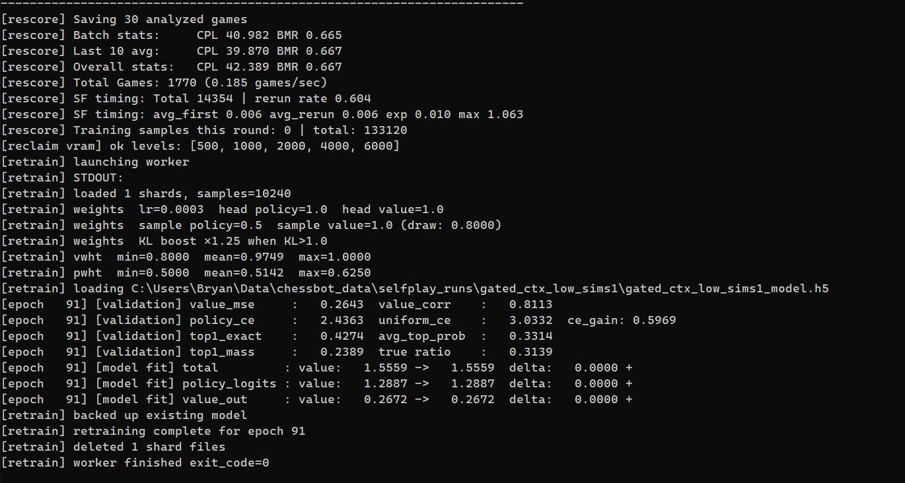
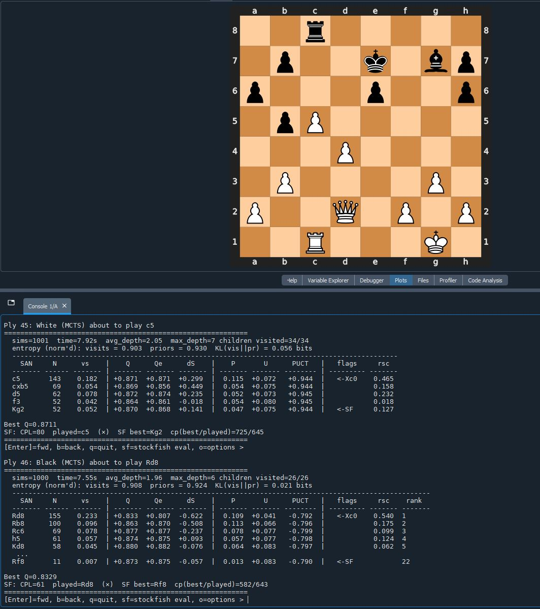
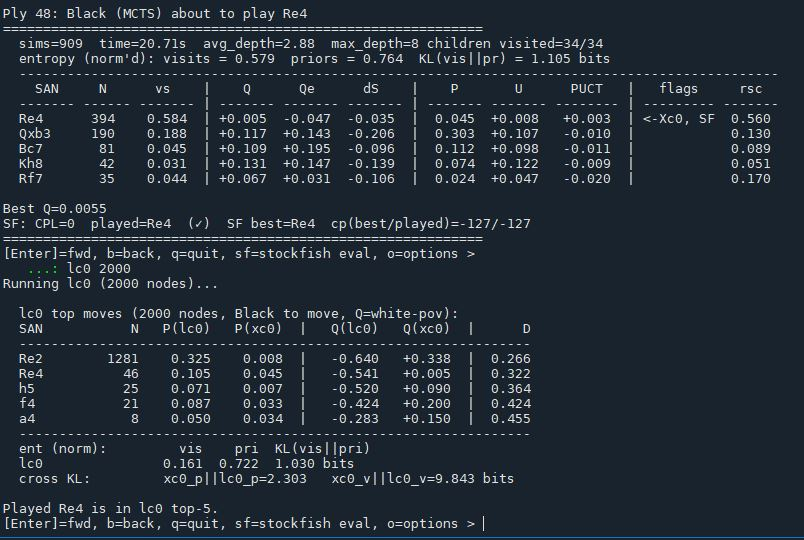
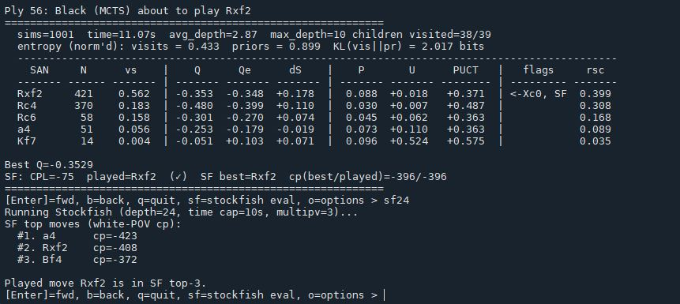

# Xerces (Xc0)

MCTS chess engine with a neural network policy/value head, trained through
self-play with Stockfish rescoring and lc0 teacher corrections.

- PUCT Monte Carlo Tree Search in C++ (`pyfastchess`), with a learned
  search controller that decides when to stop or extend each search
  (`SEARCH_CONTROLLER.md`)
- Neural network: convolution + transformer hybrid (m137_8c8t), WDL value
  and 1858-move policy, run with ONNX Runtime + TensorRT fp16
- Stockfish post-hoc rescoring for blunder detection and visit
  redistribution
- Retrain loop running between self-play rounds

## Project files

- `CHANGELOG.md`: brief notes on finished features. Entries are added once a
  feature is done developing and tuning, not on every change.
- `ROADMAP_SEARCH.md`, `ROADMAP_MODEL.md`, `ROADMAP_INFRA.md`: planned work.
  `ROADMAP_IDEAS.md`: ideas not on the agenda.
- `docs/` is out of date and will be replaced.

# Telemetry

## Selfplay

  

Live stats during self-play: moves/sec, leaf evals/sec, games/hour, cache
hit rate, PUCT stats, per-scenario results.

## Retrain Loop

  

Retraining runs as a subprocess between self-play rounds.

## MCTS Move Analysis

  

Post-hoc analysis via `review.py::GameViewer`: visit counts, policy prior vs
search distribution, Q values, PUCT contributions, entropy, KL divergence,
and Stockfish comparison.

## Lc0 Comparison

  

Compare Xerces policy outputs against Leela Chess Zero. Summon during game
review with `Lc0 n nodes`.

## Deeper Stockfish Evaluation

  

Re-run Stockfish on any position during game review via `sf <depth>`.

# Setup

    pip install -r requirements.txt
    export PYTHONPATH=./src

`pyfastchess` is a separate repo, built with `pip install -e .`.

# Quick Start

    python scripts/init_new_run.py ...          # create a run dir and config
    python scripts/run_selfplay.py <run_tag>    # self-play + retrain loop
    python scripts/run_validation_only.py ...   # validation games only

Run configs live at `<selfplay_dir>/<run_tag>/config.yaml`.
