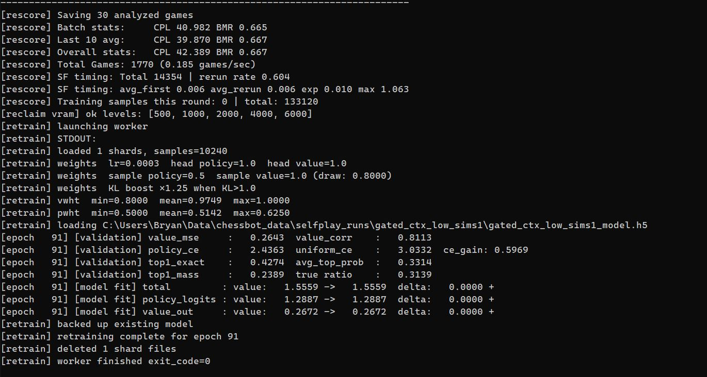

# Rescoring & Retraining

## Rescoring Overview

After a game finishes, it isn't used for training directly. The raw selfplay data contains noisy outcome labels and visit distributions that reflect the current (imperfect) model. The `Rescorer` processes each finished game asynchronously, runs Stockfish analysis on every position, and builds cleaner training targets before anything reaches the training queue.

## SF Analysis Pipeline

Each game pickle contains the full move history and per-ply NN outputs. `Rescorer.start_game()` iterates through the plies and submits positions to the Stockfish queue for analysis. Results come back asynchronously via `handle_sf_result()`, which stores the best move, centipawn evaluation, and WDL triple for each ply. Every position gets full analysis — an earlier position-keyed cache (`SFCache`) that skipped re-analysis of repeated positions was tried and removed; it wasn't paying off.

## Training Targets

The value target for each ply is a blended 3-component WDL:

```
Y = 0.5 * z_wdl + 0.5 * sf_wdl
```

where `z_wdl` is the game result converted to WDL and `sf_wdl` is Stockfish's WDL at that ply. When SF analysis is unavailable, the target falls back to `z_wdl` alone. Blending the outcome with Stockfish's read keeps the target grounded in what actually happened while pulling it toward a stronger positional signal — an earlier variant also mixed in the MCTS search WDL, but that component was dropped.

## Blunder Handling

After SF analysis is complete, `finalize_game()` scores every ply by centipawn loss against Stockfish's best move. The blunder threshold depends on the outcome: it is stricter for the side that went on to lose or draw than for the side that won. Each ply's policy target is the raw search visit distribution, with every legal move floored at one visit. What happens next depends on how bad the move was:

- **Below the blunder threshold:** the ply trains on its own visits, unmodified. There is no Stockfish blending in the band between "equivalent" and "blunder"; search is trusted there.
- **True blunder:** the ply is sent to the LC0 teacher, and the teacher's samples replace Xerces's own for that position (see LC0 Teacher below). A true blunder is one that crosses the threshold and didn't still leave the mover clearly winning.
- **Blunder the teacher can't take** (e.g. the position has castling rights): the visit policy is blended toward a Stockfish point mass on its best move. The blend strengthens with the size of the loss. If the mover won the game anyway, the blend is skipped, and the model is trusted over Stockfish.

## Blunder Replay Pool (BRP)

Fixing a blunder in the training data doesn't prove the model stopped making it. The blunder replay pool tracks the positions where Xerces actually went wrong and keeps re-testing them as the model trains.

**Admission.** After rescoring, each ply is checked against a small set of candidate rules, all requiring that the mover then drew or lost the game:

- a balanced position thrown away by a large centipawn loss
- a clearly better position played into equality or worse
- a winning position given back
- a decisive or mating advantage squandered

Only games traceable from the standard start position or a book line qualify (startpos, UHO, the opening books and validation games), because the position is rebuilt by replaying the move history. Before a candidate is admitted, the LC0 teacher is asked about it. If the teacher answers cleanly, the blunder is correctable rather than an artifact of Stockfish's search horizon, and it joins the pool with the teacher's move banked as a target.

**Probing.** Every tenth retrain runs a bulk BRP round: up to a quarter of the pool is replayed. Positions are drawn on recency of their last probe, so each one gets a rest between challenges. Each probe is a fresh Xerces search from the blunder position, and its move is scored by Stockfish:

- **Pass:** Xerces finds the best move or one within a small equivalence margin. The position is evicted as solved.
- **Fail:** the position stays in the pool. Stockfish's budget for that position rises on each failure until a deep, cached evaluation locks in the best move, so repeat probes become cheaper and more reliable.
- **Third fail:** the position is escalated to the LC0 teacher, which plays it out and contributes training samples (see LC0 Teacher below).
- **Past five fails:** the position is retired, which keeps the pool from filling with positions the current model can't learn yet.

Pass rates, fail depths and positions that keep failing are logged per round, which gives a direct read on whether the model is actually learning from its mistakes, independent of the validation ladder.

## Collar Rescoring

The eval collar tracks consecutive plies where one side's evaluation stays above a threshold. When the collar fires, it retroactively adjusts the game result label for the affected stretch of plies, overriding the final game outcome with the collar evaluation. This corrects for cases where a clearly winning position was eventually drawn or lost due to adjudication noise or model error, keeping the value targets honest about who was winning at each point in the game.

## Sample Acceptance

Every position from a game trains unless its sample goes to the LC0 teacher instead (true blunders), or the ply was flagged to skip training at game time. When a position goes to the teacher through a stream that still keeps the xc0 sample (policy/value misses, pool candidates), that xc0 sample trains at half weight and the teacher's samples at full.

**KL boosting.** On plies where the played move was sound, positions where search disagreed sharply with the network's first guess get more weight. The KL divergence between prior and visits is tracked as running median and 80th-percentile estimates. Plies above either mark have their policy weight multiplied up, and the same is done for the value weight using a value-side KL. This reweights informative positions rather than filtering anything out.
## LC0 Teacher

Stockfish can say a move was a mistake, but its single best move is a thin policy target. For positions where Xerces is known to go wrong, a Leela network acts as a **search teacher**. A dedicated lc0 worker runs the network through the same ORT+TensorRT machinery as selfplay (the `lc0_trt` backend) and plays a short probe from the flagged position, currently 3 plies of full MCTS. Every ply it plays becomes a training sample: straight visit distribution and WDL, at full weight. The teacher's moves and visits are mapped into Xerces's 1858 move domain (`lc0_utils`).

Positions reach the teacher through a few streams, all on one queue and deduplicated per ply:

- **True blunders.** A ply Stockfish rates as a real blunder is sent to the teacher instead of training on Xerces's own (wrong) visits. The xc0 sample is dropped.
- **Blunder replay escalations.** Positions from the blunder replay pool that Xerces keeps failing are escalated to the teacher (see below).
- **Policy/value misses.** A ply that wasn't a true blunder but still lost meaningful ground, where Stockfish's move sits outside Xerces's top candidates by visits or by prior, or where the prior liked it and search didn't. The xc0 sample still trains here, at half weight, alongside the teacher's.

Teacher samples are collected in their own `lc0_buffer` and flushed as pure-lc0 shards. The retrain draw gives these shards priority, so the corrected signal reaches the model quickly instead of being diluted across the whole buffer. Positions with castling rights are skipped, because lc0 and Xerces index castling moves differently. The teacher is entirely optional: with no lc0 model configured, no lc0 worker is spawned and rescoring runs on Stockfish alone.

## Retraining



Retraining runs in a fresh process (`retrain_worker.py`) spawned for each cycle and torn down afterwards. On an 8GB GPU, selfplay inference and training can't share VRAM comfortably; a process that exits releases all of its GPU memory, so workers always resume on a clean slate.

**The buffers.** Rescored samples accumulate in a live buffer and are written out as fixed-size shards into three tiers:

- **Primary**: fresh selfplay shards not yet trained on, plus the pure-lc0 teacher shards.
- **Replay**: primary shards that have already been through one retrain.
- **Historic**: a read-only slice of the bootstrap corpus (lc0 and early Xerces data). It anchors the model to the pretraining distribution and can be drawn again and again.

**The draw.** A retrain fires when the primary tier fills up. Each retrain draws a fixed mix of 12 primary + 12 replay + 4 historic shards. The primary draw reserves slots for lc0 teacher shards (two when several are waiting, one otherwise), so teacher corrections land within a retrain or two of being produced. After a successful retrain, the trained primary shards rotate into replay and the replay shards that were drawn are discarded. Every selfplay sample therefore trains exactly twice: once fresh, once as replay.

**The cycle.**

1. The worker loads the shards and, **before training**, runs the current model over held-out slices of primary (pure xc0), historic and lc0 data. These predictions become the per-epoch validation metrics, scored on data the model has never trained on.
2. It shuffles primary records across shard boundaries, mixes in replay and historic, and tells the orchestrator it is ready.
3. The orchestrator pauses selfplay. The worker waits until every selfplay worker confirms it has released its GPU sessions (with a timeout backstop), then allocates and trains.
4. Training is a single pass with **AdamW** (decoupled weight decay on matrix and conv weights only; biases, norm gains and PReLU slopes are exempt), fp16 autocast and gradient clipping. The AdamW moments and the GradScaler state persist across retrains, so the optimizer behaves like one continuous run rather than restarting cold every cycle. Weights are used directly; there is no EMA of the player.
5. On completion, the orchestrator rebuilds the TRT engine, unpauses selfplay on the new weights, and only then aggregates the validation metrics. Workers are never kept waiting on bookkeeping.

The retrain view shows per-epoch metrics:

- **value CE** — cross-entropy of the model's WDL predictions against the blended training targets.
- **value correlation** — Pearson correlation between predicted and target scalar values (`win - loss`). Tracks whether the model's ordinal ranking of positions improves even when absolute calibration is noisy.
- **policy CE** — cross-entropy of policy logits against the rescored visit distribution targets.
- **top-1 accuracy** — fraction of positions where the model's top policy move matches the training target's top move.
- **CE gain vs uniform** — policy CE improvement over a uniform distribution baseline, measuring how much the model has learned to concentrate probability on good moves.
