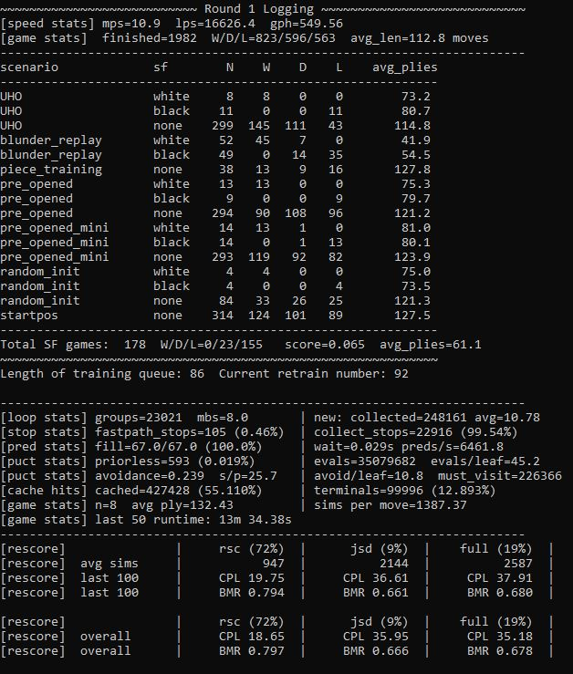

# Selfplay Suite

## Orchestration

`scripts/run_selfplay.py <run_tag>` starts a run. All of the run's long-lived state lives in one object, `SelfPlayRunner` (`src/chessbot/selfplay_runner.py`), whose main loop does everything on one thread, in order: reap and respawn dead workers, keep the game queue topped up, drain finished games into the rescorer, tick rescoring, and launch or poll a retrain.

**Processes.** The runner manages a small fleet:

- **xc0 workers**: each runs `child_looper()` → `GameLooper`, playing many games concurrently with batched GPU inference.
- **lc0 worker**: runs the LC0 teacher probes on its own queue (see [Rescoring & Retraining](evaluation_pipeline.md)).
- **Stockfish rescore threads**: analyze finished games. One extra thread is added automatically while the rescore backlog is deep and retired once it clears.
- **Retrain worker**: spawned fresh for each retrain and torn down afterwards.

**One game queue.** Selfplay games, validation games and blunder-replay probes all ride a single FIFO queue that every xc0 worker pulls from. At startup it is seeded in priority order: probes first (they're single-move, so Stockfish has work within seconds), then validation, then selfplay, filled deep enough to bring every worker slot up at once. Workers report finished games and telemetry back on their own queues, and receive pause, unpause and reload commands on a per-worker message queue.

**Retrain boundary.** When the primary buffer fills, the runner spawns the retrain worker, pauses selfplay once the worker is ready, and lets it train only after every worker has released the GPU. When training finishes, the runner re-reads the run's config (so edits take effect at each retrain boundary without a restart), rebuilds the TRT engine, and unpauses the fleet on the new weights. Validation batches and bulk BRP rounds are scheduled off the same retrain counter.

**Unattended runs.** `scripts/run_selfplay_loop.py` wraps the runner for long campaigns. It runs a tag to its game budget, iterates into the next tag (cloning its config), and relaunches on crashes, silent hangs or stalls, killing orphaned workers and engines first. It halts safely on repeated failures or low disk. An operator console on stdin (`stop`, pause/resume, worker and Stockfish scaling) stays available throughout.



The live telemetry view aggregates across all workers and updates each reporting interval. Key metrics: moves/sec (MPS) and leaf evaluations/sec (LPS) reflect game and NN throughput respectively; games/hour gives the effective data generation rate; cache hit rate shows what fraction of leaf collections were resolved by the C++ priors cache without NN inference; PUCT stats and per-scenario W/D/L breakdowns make it easy to spot if one game type is producing systematically lopsided results.

## GameLooper

`GameLooper` manages a pool of `active_games` (up to `games_at_once` concurrent `ChessGame` instances) and drives the inference loop. Every tree is registered with a single C++ `MCTSForest`, which owns leaf collection and board encoding across all games at once — the Python loop never touches individual leaf boards.

Each iteration:

1. `forest.resolve_all_inflight()` — settle any leaves whose NN results arrived last iteration.
2. For each active game, `game.tree.collect_many_leaves(this_mbs, max_fastpath)` gathers new leaf nodes that need NN evaluation. Cache hits and terminals are resolved in C++ and don't surface here. A per-game `micro_batch` sets the target leaf count; unused budget rolls into a `bonus` that lets the next game temporarily double its microbatch, keeping the aggregate batch full.
3. `batch_encoder()` — one C++ call (`forest.get_all_encoded`, or `get_all_lc0_features` for the `lc0_trt` backend) returns `(keys_np, enc_np)`: the zobrist keys and encoded boards for every pending leaf in the forest.
4. `format_and_predict(keys, enc)` — the encoded batch is sliced into `macro_batch` chunks and run through `infer(...)`, returning `(policy_logits [B, 1858], wdl [B, 3])`. `raw_cache_bulk_insert_np(keys, wdl, logits)` writes results into the C++ raw cache, where masking/softmax happen in `build_priors`.
5. On the next iteration `resolve_all_inflight()` expands the waiting nodes and backpropagates.
6. Games that reach a terminal state are popped from the forest, finalized (serialized to pickle and enqueued for rescoring), and removed from `active_games`; `pull_from_queue()` refills the pool.

The inference step is intentionally kept as the sole GPU operation. There is no per-game GPU work; encoding, cache lookups, and tree updates are all CPU-side C++, with Python only orchestrating.

**Pause and reload.** When the main process sends a pause signal, `GameLooper` tears down the inference session (`del self.infer`/`del self.model`), calls `torch.cuda.empty_cache()` for the PyTorch backends (the TRT backends need no explicit free), clears the priors cache, and blocks on the message queue until an unpause arrives. An unpause that arrives early is buffered so the wait can't deadlock. On resume it reloads the model from the path in the unpause message and rebuilds the inference function. VRAM is released before the retrain subprocess starts so both fit on the same GPU.

## StockfishThread

`StockfishThread` runs a Stockfish engine on a background daemon thread, handling positions that need engine evaluation during selfplay — primarily for games played against Stockfish and for the vs-SF validation rounds.

Games submit a (game_id, board_fen) pair via `submit()`. The thread drains its input queue, runs Stockfish to the configured depth, and pushes (game_id, result_tuple) to a response queue. The result tuple contains `(eval_cp_stm_pov, best_move_uci, wdl_tuple)`. Games poll the response queue at the start of each move.

## Game Curriculum

`GameGenerator` selects starting positions according to a weighted scenario mix configured per run. The mix leans heavily on real openings: half of all games start from the initial position and most of the rest come from opening books and UHO, while the synthetic scenarios are a small minority. The active m137_8c8t curriculum is:

| Scenario | Weight | Description |
|---|---|---|
| `startpos` | 50% | Standard starting position |
| `UHO` | 24% | Unbalanced Human Openings, white to move at ply 16 |
| `pre_opened` | 10% | Longer opening lines (> 2 moves) |
| `pre_opened_mini` | 9% | Short opening lines (<= 2 moves) |
| `random_init` | 3% | Random legal position from the opening phase |
| `piece_odds` | 2% | Material-unbalanced positions |
| `piece_training` | 2% | Focused endgame piece training positions |

UHO positions come from `UHO_XXL_2022_+100_+129.pgn`, a corpus of unbalanced human games. All UHO positions are white-to-move at ply 16, ensuring the engine sees non-trivial positions with varied pawn structures early in training.

## Game Adjudication

Games terminate on checkmate or draw by the rules, but several early-exit conditions are also active:

- **Eval collar** — if one side's evaluation stays above a threshold for `collar_n_consec` consecutive moves, the game is adjudicated as a win for that side.
- **Eval draw** — if all evaluations within a rolling window stay near zero, the game is adjudicated as a draw.
- **Max game length** — hard cap to prevent runaway games.

Syzygy tablebase adjudication (<= 5 pieces) and material-diff cutoffs are also configurable per run. The adjudicator flags in effect for a game are recorded with its training data so rescoring knows how each outcome was reached.

## Bootstrap Data Pipeline

Before self-play begins, the model is pretrained on a large static dataset built
from two sources. `scripts/data/build_bootstrap_records.py` is the canonical
tool for this.

**lc0 source** — lc0 V6 binary training chunks decoded directly to xc0h tokens
via `v6_planes_to_xc0h` (no float32 intermediate). Draws are dropped at 50%.
3 workers each drain a disjoint chunk subset.

**xc0 source** — Xerces selfplay game logs from historical run tags. For each
game that passes a `GAME_CPL_MAX=20` filter, plies with SF analysis loss
<= `MOVE_CPL_MAX=15` and tree search data are extracted. The board is replayed
through `board.history_tokens(K=6)` via pyfastchess to produce the xc0h
encoding, preserving full opening history via warm replay of the prefix. SF
moves are skipped. 4 workers each handle a disjoint subset of run tags.

Both sources produce records with schema:

```
xc0h_board  int16[393]    K=6 history frames + meta tokens
policy      float32[1858] normalized visit distribution (no clipping)
wdl         float32[3]    Z_BLEND * result_wdl + (1-Z_BLEND) * search_wdl
```

Target is 20M records per source (40M total). Output goes to a staging
directory, then a single shuffle pass via `scripts/data/shuffle_xco.py`
produces the final training-ready shards.
